# Claude Code Kit (CCKit)

**[Claude Code](https://claude.ai/code) CLI 의 주요 명령·작업을 Windows UI 패널로 클릭 한 번에 조작**

터미널에서 `/remote-control`, `/bg`, `/rename`, `claude --resume`, `claude agents` 같은 명령을 일일이 치는 대신 — 트레이에 상주하는 컨트롤 패널에서 세션을 **열고·닫고·관리하고, 백그라운드로 보내고, 폰/웹에서 원격 조종**할 수 있습니다.

<p align="center">
  <a href="https://github.com/hull-kr/Claude-Code-Kit/releases/latest/download/CCKitSetup.exe">
    <b>⬇️ 다운로드 — CCKitSetup.exe</b>
  </a>
  &nbsp;·&nbsp; Windows 10/11 &nbsp;·&nbsp; 무료(Freeware)
</p>
<p align="center">
  <sub>크롬이 <code>.exe</code> 다운로드를 막으면 <a href="https://github.com/hull-kr/Claude-Code-Kit/releases/latest/download/CCKitSetup.zip">CCKitSetup.zip</a> 을 받아 압축을 풀고 실행하세요.</sub>
</p>
<p align="center">
  <sub>📖 자세한 사용법은 <a href="https://claudecodelab.tistory.com/2">여기서 확인하세요</a>.</sub>
</p>
<p align="center">
  <sub>🍎 Mac 버전은 <a href="https://github.com/hull-kr/Claude-Code-Kit-Mac">여기서 받으세요</a>.</sub>
</p>

> 🆕 **v1.3.0 - 타사 API 설정**: Claude 구독 대신 **OpenRouter 키로 다른 회사 모델(GPT-5.6 Luna 등)을 Claude Code 에서** 쓸 수 있습니다. 폴더(프로젝트)별로만 적용되고 전역 설정은 건드리지 않습니다. → [자세히 보기](#third-party-api)

<p align="center">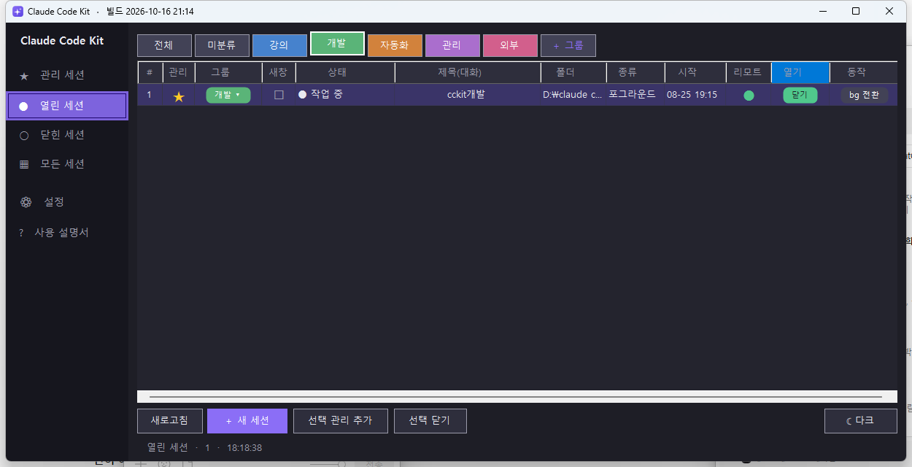</p>

---

## 🎛️ CLI 명령 ↔ UI 매핑

터미널에서 치던 것을 패널 버튼으로:

| Claude Code CLI | CCKit 패널 |
|---|---|
| `claude` (새 세션) | **＋ 새 세션** 버튼 (폴더·이름·원격 옵션) |
| `claude --resume <id>` | 닫힌 세션 **열기** / **전체 이어서 열기** |
| `/remote-control` | 세션의 **리모트** 토글 |
| `/bg` (백그라운드) | **bg 전환** 버튼 |
| `/rename` | **제목 칸 더블클릭** |
| `claude agents` | 상태칸 **🔹N 뱃지 → 클릭** (서브에이전트 목록) |
| `claude attach <id>` | 백그라운드 **화면표시** |
| 이미지 경로 입력 | **Ctrl+Shift+V** (클립보드 이미지 자동 저장·입력) |

> ℹ️ **`ccd`** 는 Claude 순정 명령이 아니라 **CCKit 이 추가하는 단축 명령**입니다 (`ccd = claude --dangerously-skip-permissions`). 아래 [ccd 단축 명령](#️-ccd-단축-명령) 참고.

---

## 📥 설치

1. 위 **다운로드** 버튼으로 `CCKitSetup.exe` 받기 → 실행
2. **⚠️ "Windows의 PC를 보호했습니다" 경고가 뜹니다.**
   이 프로그램은 **무료 자유 소프트웨어라 코드 서명(유료 인증서)을 하지 않았습니다.**
   해로운 게 아니라, 서명이 없어 Windows가 습관적으로 띄우는 경고예요.
   → **`추가 정보`** 클릭 → **`실행`** 누르면 설치됩니다.
3. **선행 프로그램 선택** — 설치할 것에 체크합니다 (아래 참고).
4. 설치 후 트레이 아이콘(또는 바탕화면 아이콘) 더블클릭으로 패널을 엽니다.

### 🧩 선행 프로그램도 같이 깔아줍니다

**아무것도 없는 새 PC라면 이것만 실행하면 됩니다.** 설치 마법사가 **Node.js · Git · Python · Claude Code** 를 함께 설치합니다.

- **공식 사이트에서 직접** 내려받습니다 — `nodejs.org` · `git-scm.com` · `python.org`
- 항상 **최신판**을 자동으로 찾아 받습니다
- **`Program Files` 같은 표준 위치**에 설치되고, **PATH도 각 설치 프로그램이 직접 등록**합니다
- 다운로드 **진행률**과 설치 진행 상황이 화면에 표시됩니다
- 이미 깔려 있는 것은 **버전과 함께 "설치됨"으로 표시되고 체크가 꺼져 있습니다.** 체크하면 최신판으로 다시 설치합니다

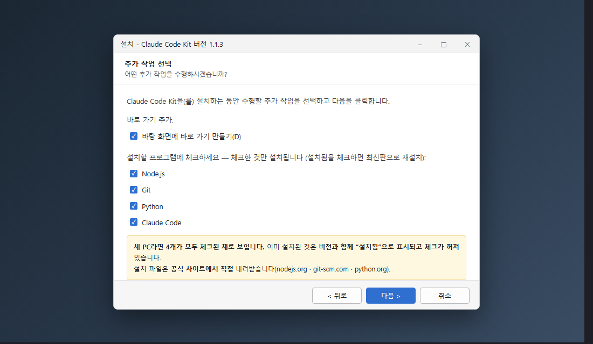

> 💡 **Claude Code 도 여기서 같이 설치됩니다.** 미리 깔아둘 필요 없습니다.
> Windows Terminal 도 없으면 자동으로 설치합니다.

### 명령이 인식되지 않을 때

`claude` · `node` 명령을 못 찾는다고 나오면, **터미널을 닫고 새로 여세요.** PATH는 프로그램이 시작될 때 한 번만 읽히기 때문입니다.

그래도 안 되면 **설정 → `환경변수 등록/복구`** 를 누르세요. 표준 위치뿐 아니라 winget 설치 위치, 사용자 폴더 설치 위치까지 전부 찾아 PATH에 등록합니다.

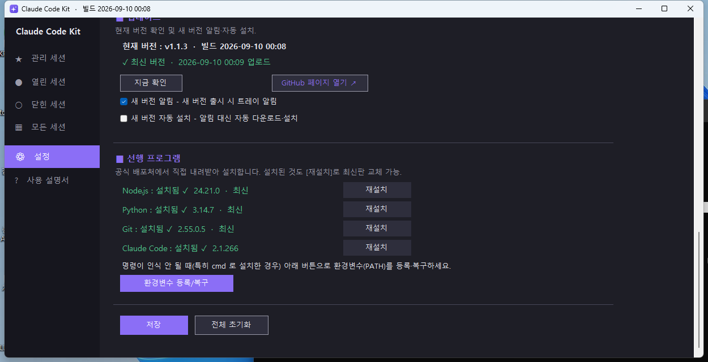

설정 화면에서 각 프로그램의 **설치 여부 · 버전 · 최신판인지**를 한눈에 볼 수 있고, `재설치` 로 언제든 최신판으로 바꿀 수 있습니다.

---

## ⭐ 주요 기능 요약

| 기능 | 한 줄 요약 |
|---|---|
| 🖼️ **이미지 붙여넣기** | `Ctrl+Shift+V` 로 클립보드 이미지 저장 + 경로 자동 입력 |
| 🗂️ **컨트롤 패널** | 세션 열기·닫기·관리, 상태 색, 다중 선택, 정렬 |
| 🖱️ **우클릭 메뉴** | 세션 하나로 할 수 있는 모든 것(재시작·리모트·관리·bg전환·이름변경 등)을 그룹으로 |
| ➕ **새 세션** | 폴더·이름·원격·관리 옵션으로 새 세션 한 번에 생성 |
| 🌙 **bg 전환** | 실행 중 세션을 백그라운드로 (창 닫고 계속 실행) |
| 📱 **리모트 컨트롤** | 폰/웹(claude.ai/code)에서 이 PC 세션 조종 |
| 🔹 **서브에이전트 표시** | 상태칸 `🔹N` → 클릭 시 작업 중 에이전트 목록 |
| ★ **관리 / 이어서 열기** | 즐겨찾기 세션 + 한 번에 복원 |
| 🔄 **리붓 자동 복원** | 로그인 시 리붓 직전 세션 자동 복원 |
| 🧩 **선행 프로그램 설치** | Node.js·Git·Python·Claude Code 를 공식 사이트에서 직접 받아 설치 |
| ⏳ **세션 보관 기간 · 기간만료 표시** | Claude Code 의 대화 자동 삭제 기간을 설정에서 조정, 사라진 이유를 "기간만료"로 바로 표시 |
| 🔑 **로그인 확인** | API 키(환경변수·settings.json) 상태 확인·저장·비우기 + 구독 로그인 상태 확인·진행 |
| 🌐 **타사 API 설정** | OpenRouter 키로 다른 모델(GPT 등) 사용 - 프로필 저장, 세션 우클릭으로 폴더별 적용·해제 |
| 🌐 **다국어** | 한국어 / English / 日本語 / 中文 |

---

## ✨ 기능 상세

### 🖼️ 이미지 붙여넣기
캡처(`Win`+`Shift`+`S`) 후 터미널에서 **`Ctrl`+`Shift`+`V`** → 클립보드 이미지가 현재 폴더에 저장되고 그 경로가 자동으로 입력됩니다.

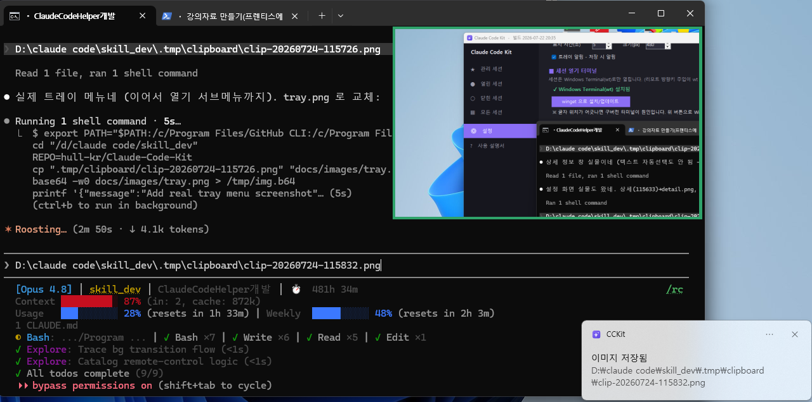

### 🗂️ 컨트롤 패널
- **탭:** ★관리 / ●열린 / ○닫힌 / ▦모든 세션 / ⚙설정 / ?사용법
- **상태 색:** 작업 중(주황) · 대기(초록) · 닫힘(회색)
- **각 세션 버튼:** 관리(★)·리모트·열기·bg 전환·닫기/삭제 — 여러 개 선택해 한꺼번에도
- **더블클릭:** 상태칸=상세정보, 제목칸=이름 바꾸기
- **모든 세션** 탭에서 열린·닫힌 세션을 한눈에 (닫힌 세션 열기/삭제, 빈 세션 정리)

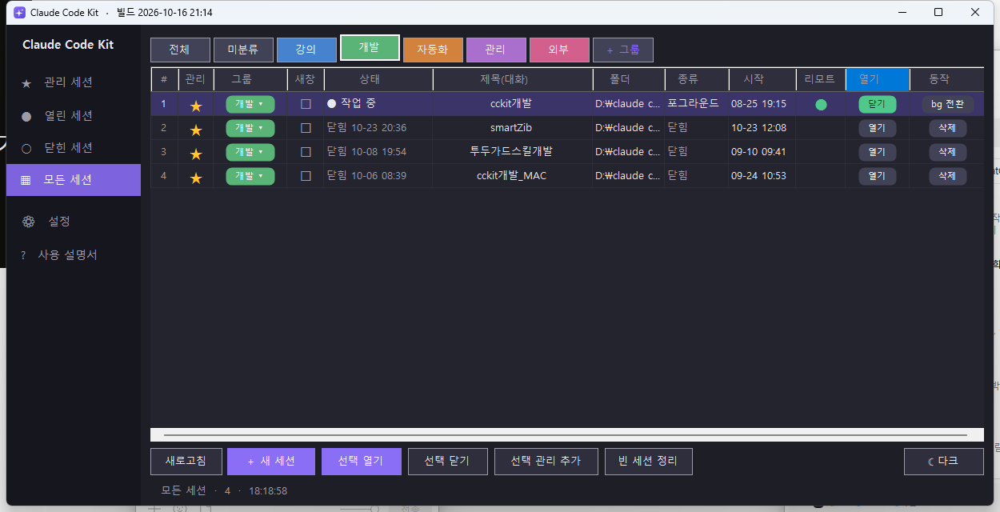

### 🖱️ 우클릭 메뉴
세션 행을 **우클릭**하면 그 세션으로 할 수 있는 것이 전부 그룹으로 모여 뜹니다. 지금 상태에 맞는 항목만 자동으로 나옵니다(리모트가 켜져 있으면 "리모트 끄기", 관리 세션이면 "관리 제거").

- **정보** — 상세 정보, 세션ID 복사
- **탐색** — wt 보기, 폴더 열기, 이름 바꾸기
- **그룹** — 그룹 지정 · **타사 API 설정**(프로필 적용/해제, 지금 적용된 것에 체크 표시)
- **상태 전환** — 세션 재시작(닫고 바로 다시 열기) · 리모트 켜기/끄기 · 관리 추가/제거 · bg 전환
- **닫기/삭제** — 아래쪽에 따로 구분

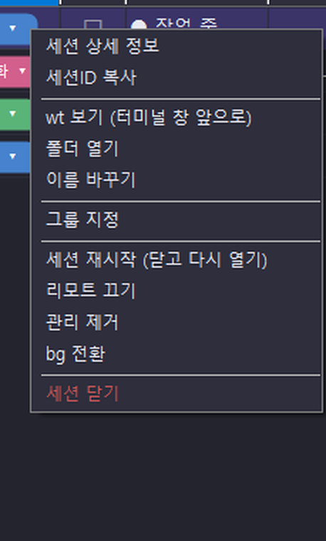

### ➕ 새 세션
하단 **`＋ 새 세션`** → 폴더 선택 + 세션명 + **원격 연결**(기본 켜짐) + 관리 추가(선택) + **타사 API 프로필**(선택, 안 고르면 클로드 모델). 새 폴더의 "이 폴더를 신뢰?" 물음은 자동 통과, 이름도 자동 지정.

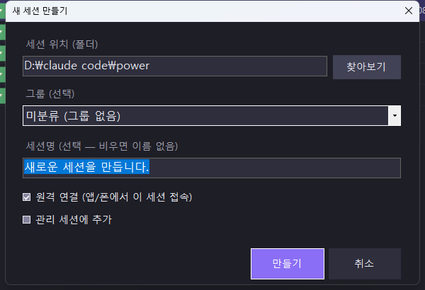

### 🌙 bg 전환
실행 중 세션을 백그라운드로 보냅니다. 탭은 닫히고 세션은 계속 실행 — 이름 앞에 `[MMddHHmm]` 시각이 붙습니다. **화면표시**로 언제든 다시 봅니다.

### 📱 리모트 컨트롤 — 폰/웹에서 이 PC 조종
세션의 **리모트**를 켜면 `/remote-control` 이 실행돼, **claude.ai/code 또는 모바일 Claude 앱**에서 그 세션이 그대로 보이고 조종됩니다. (이름 없는 세션은 리모트 켜는 순간의 최신 대화가 제목이 됩니다 — 앱과 동일)

**실제 흐름:**

1. 세션에서 대화 → 2. 패널에서 **리모트** 켜기 → 3. "리모트를 켰습니다" → 4. 패널에 **● 켜짐** → 5. **claude.ai/code(웹/앱)에서 그 세션 조종**

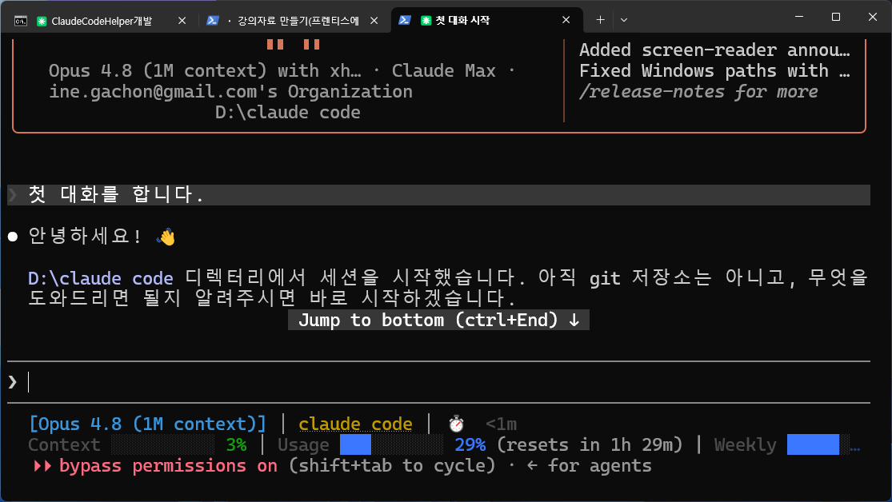<br>
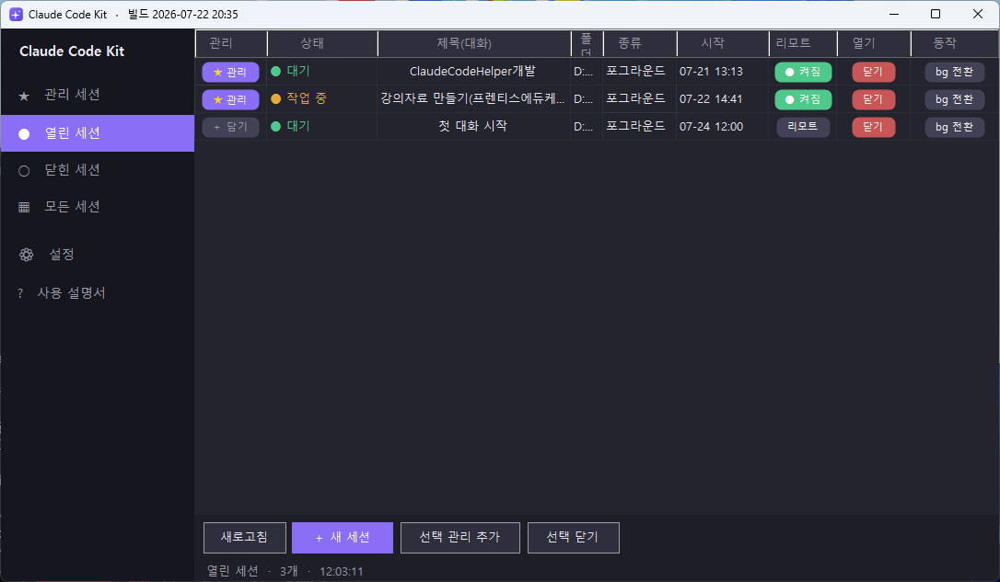<br>
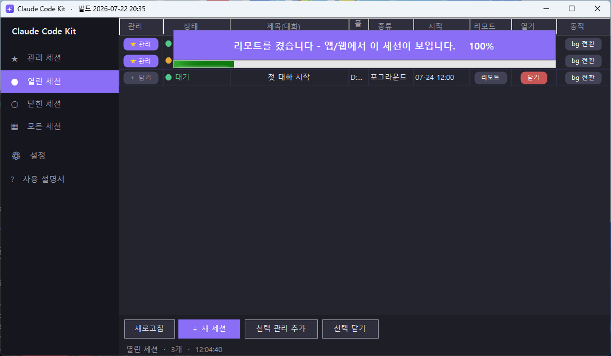<br>
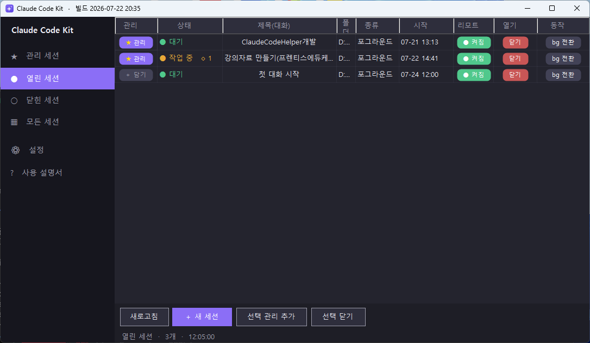<br>
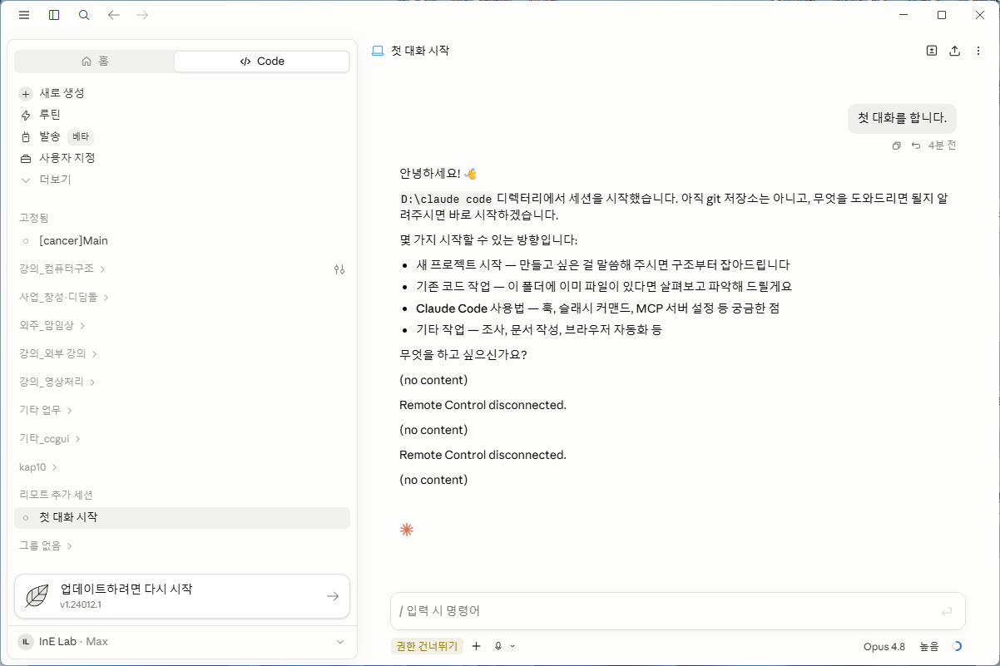

### 🔹 서브에이전트 표시
세션이 Task/Agent 를 돌리면 상태칸에 **`🔹N`** 뱃지 → 클릭하면 작업 중인 서브에이전트 목록 팝업 (끝나면 자동으로 사라짐).

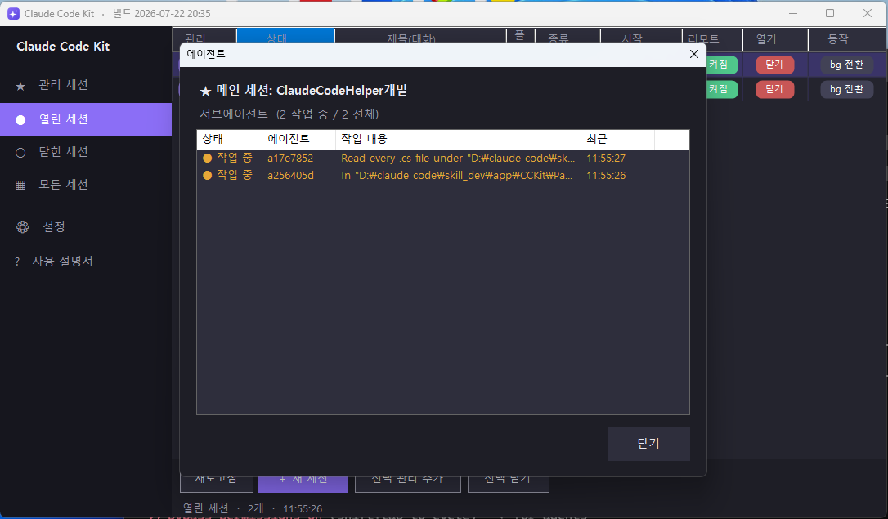

### ★ 관리 세션 / 이어서 열기
자주 쓰는 세션을 **관리(★ 금색 별)** 에 담아두면 닫혀도 '관리 세션' 탭에 남습니다. **`전체 이어서 열기`**(트레이 메뉴) 한 번이면 열어뒀던 폴더에서 대화까지 이어서 한꺼번에 다시 엽니다.

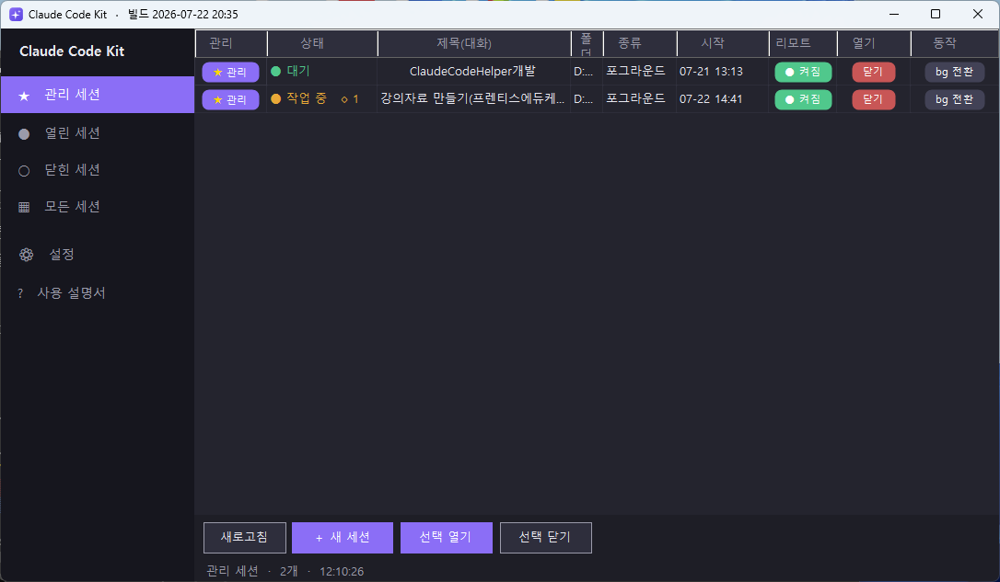

### 📋 상세 정보 · ⚙ 설정 · 트레이
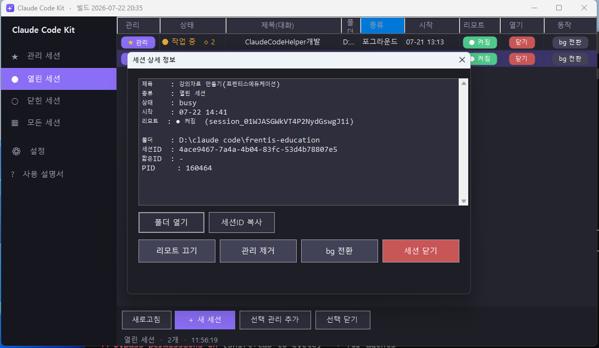<br>
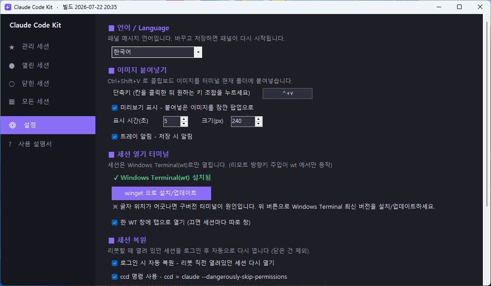<br>
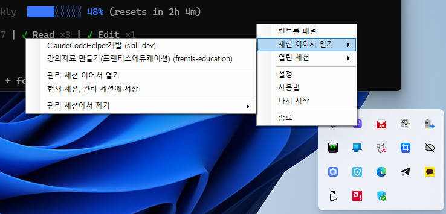

- **상세 정보**(상태칸 더블클릭): 경로/세션ID 확인·복사 + 그 세션의 모든 액션
- **설정:** 언어(한/영/일/중) · 이미지 붙여넣기 · WT 창 방식(탭/따로) · 로그인 자동 복원 · 절전 방지 · 리모트 유휴 유지
- **트레이 메뉴:** 패널 열기 · 이어서 열기 · 설치 폴더 · 다시 시작 · 종료

### 🔄 리붓 자동 복원
설정에서 켜두면 **리붓 직전 열려 있던 세션들을 로그인할 때 자동으로 다시** 엽니다.

### ⏳ 세션 보관 기간 · 기간만료 표시
Claude Code 본체는 기본적으로 **30일이 지난 세션 대화(jsonl)를 자동으로 지웁니다.** "관리 세션인데 대화가 사라졌다"의 가장 흔한 원인이 바로 이것입니다 — CCKit 이나 바이러스 백신이 지운 게 아닙니다.

- **설정 → 세션 보관 기간**에서 Claude Code 의 보관 일수(`cleanupPeriodDays`)를 바로 조정합니다. 오래된 세션도 지우고 싶지 않으면 365(1년) 등으로 늘려 두세요.
- 보관 기간이 지나 사라진 게 확실한 세션은 빨간 **"기간만료"** 로 원인을 바로 알려줍니다(관리·닫힌·모든 세션 탭 전부). 클릭하면 보관 기간 설정으로 바로 이동합니다.

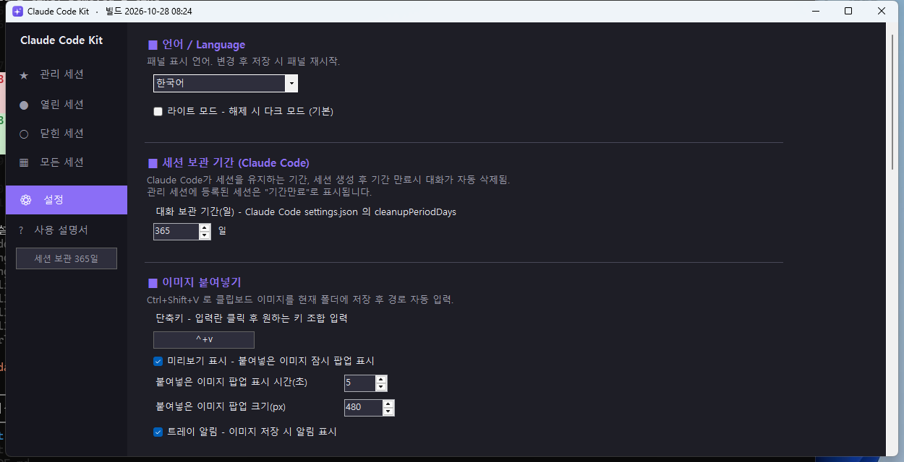<br>
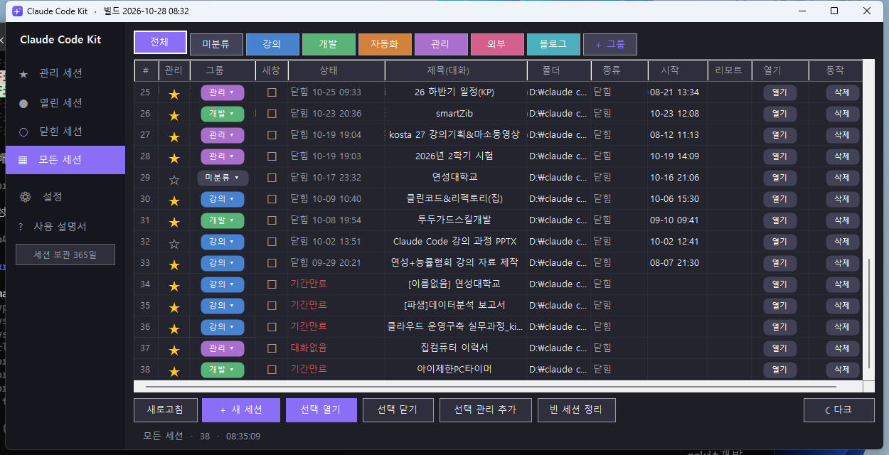

### 🔑 로그인 확인
키를 예전에 설정해두고 잊어버린 채 구독(Claude.ai) 로그인을 하면, Claude Code 가 키를 우선 써버려서 구독 로그인이 먹통처럼 보이는 경우가 있습니다. **설정 → 사용 설명서** 아래 **"로그인 확인"** 탭에서 원인을 바로 확인하고 정리할 수 있습니다.

- **API 키 설정:** OS 환경변수 / `settings.json` 의 `env` / `apiKeyHelper` 세 곳을 각각 따로 상태 확인·저장·비우기. 우선순위(OS 환경변수 > `env` > `apiKeyHelper` > 구독 로그인)도 안내.
- **구독(Claude.ai) 로그인 상태:** 로그인 여부·계정·플랜 확인, **"구독 로그인 진행"** 버튼으로 새 터미널에서 `/login` 자동 실행 — 로그인이 끝나면 그 임시 세션은 자동으로 정리됩니다.

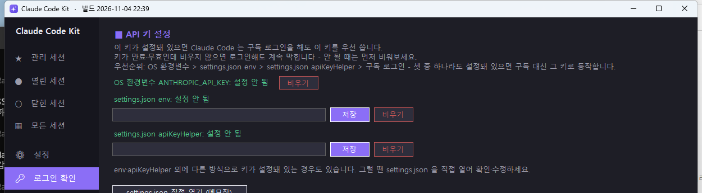<br>
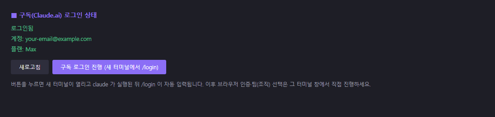

<a id="third-party-api"></a>
### 🌐 타사 API 설정 - OpenRouter 로 다른 모델 쓰기
Claude 구독 대신 **[OpenRouter](https://openrouter.ai) 키**로 다른 회사 모델(예: GPT-5.6 Luna)을 Claude Code 에서 그대로 씁니다. 코드 읽기·수정, 명령 실행, 로컬 스킬까지 평소처럼 동작합니다.

- **고른 세션 폴더에만 적용됩니다.** 다른 프로젝트는 계속 클로드 모델로 동작하고, PC 전체 설정은 건드리지 않습니다.
- git 저장소면 키가 커밋되지 않게 자동으로 막아 줍니다.

**1) 프로필 추가** - [openrouter.ai](https://openrouter.ai) 에서 키(`sk-or-v1-...`)를 발급받고 크레딧을 충전한 뒤, 패널 왼쪽 **"타사 API 설정"** 탭에서 **이름 · 모델 · API 키**를 넣고 **추가**를 누릅니다. 모델 칸은 글자 일부만 쳐도(예: `luna`) 목록에서 찾아 줍니다. `↑` `↓` 로 고르고 `Enter` 로 확정합니다.

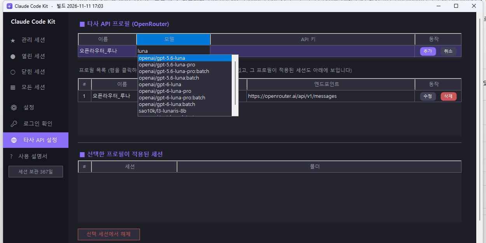

**2) 프로필 목록** - 프로필마다 번호(#)가 붙고, **수정 · 삭제** 버튼으로 관리합니다. 행을 고르면 그 프로필이 적용된 세션이 아래에 보입니다.

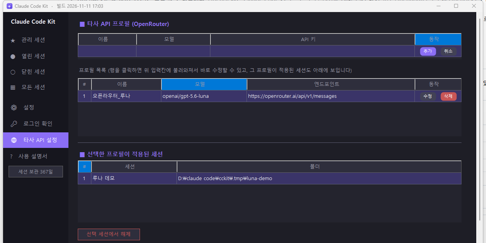

**3) 세션에 적용** - 세션 행 **우클릭 → "타사 API 설정"** 에서 프로필을 고릅니다. 지금 적용된 프로필에 체크(✓)가 붙고, 메뉴 이름 옆에 `[프로필 이름]` 이 보입니다. 되돌릴 때는 **"사용 안 함 (클로드 모델)"** 을 고르거나, 탭 아래 **"선택 세션에서 해제"** 를 누릅니다.

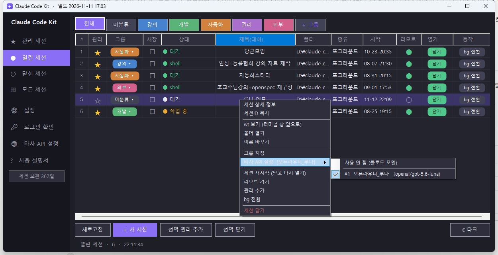

**4) 재시작** - 그 폴더에 열려 있는 세션이 있으면 지금 재시작할지 묻습니다. **예**를 누르면 닫았다가 다시 엽니다. 대화는 그대로 이어지고, 모델도 새 설정에 맞춰 자동으로 바뀝니다(해제했으면 클로드 모델로).

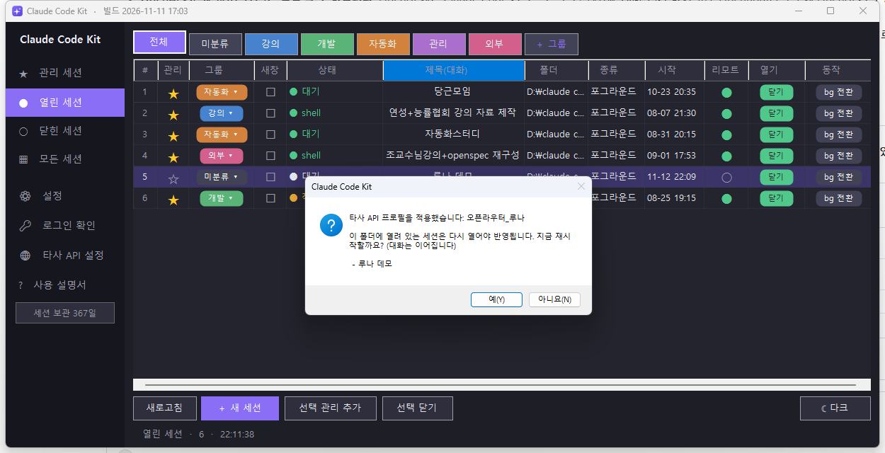

**새 세션에서 바로 쓰기** - **＋ 새 세션** 창 아래에서 프로필을 고르면 처음부터 타사 모델로 열립니다. 이때 **원격 연결** 체크는 자동으로 꺼집니다(타사 API 세션은 리모트를 쓸 수 없음).

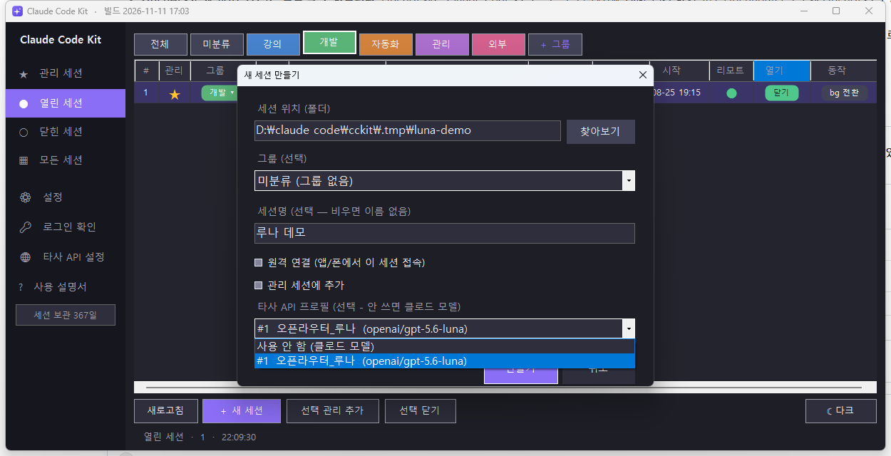

**실행 화면** - 세션 위쪽과 상태줄에 타사 모델 이름(`openai/gpt-5.6-luna`)이 보이면 적용된 것입니다.

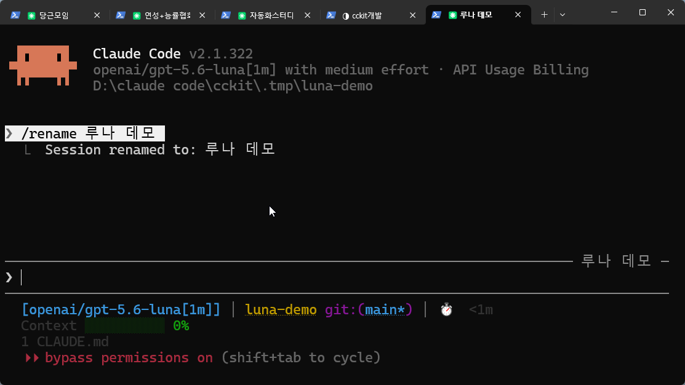

**알아둘 점**
| 항목 | 타사 API(키) 세션 |
|---|---|
| 코드 읽기·수정, 명령 실행, 로컬 파일 만들기, 로컬 스킬 | ✅ 됨 |
| Artifact · Docs · 리모트 컨트롤 · claude.ai 커넥터 | ❌ 안 됨 (claude.ai 계정 로그인이 필요한 기능) |
- 위 제한은 **Anthropic API 키로 연결할 때도 똑같습니다.** 모델이 아니라 "키 방식 로그인"이라서 생기는 제한입니다. 키 방식 세션에서는 `/login` 을 해도 키가 우선 적용됩니다.
- **OpenAI 키(`sk-proj-...`)는 직접 쓸 수 없습니다.** OpenAI 에는 Claude Code 가 부르는 주소(`/v1/messages`)가 없어 404 가 나고, OpenRouter 주소에 OpenAI 키를 넣으면 401 이 납니다. 같은 OpenAI 모델을 OpenRouter 를 거쳐 쓰면 됩니다(OpenRouter 계정에 OpenAI 키를 등록하는 BYOK 도 가능).
- 다른 회사 모델은 Claude 만큼 Claude Code 도구에 맞춰져 있지 않아 가끔 실수를 합니다. 예를 들어 GPT 계열이 Windows 경로의 `\` 를 잘못 넘겨 파일 만들기에 실패하면, 경로를 `/` 로 쓰라고 말해 주세요(`D:/project/a.docx`).
- 이 화면의 문구는 아직 한국어만 지원합니다.

### ⌨️ ccd 단축 명령
```
ccd = claude --dangerously-skip-permissions
```
어느 폴더에서든 `ccd` 만 치면 **권한 확인을 건너뛰고(bypass permissions on)** 바로 Claude Code 가 실행됩니다.

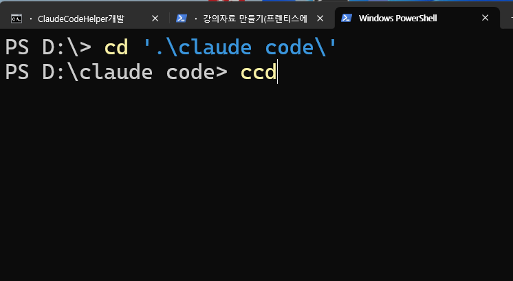<br>
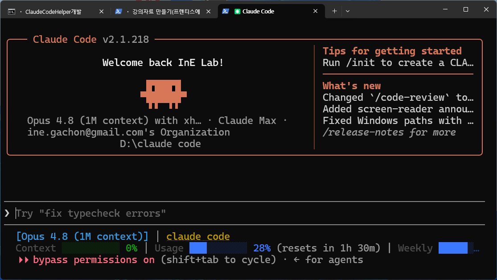

**설정 → 세션 복원 → `ccd 명령 사용`** 체크로 설치/해제합니다 (체크하면 `ccd.cmd` + PATH 자동 등록, 해제하면 제거):

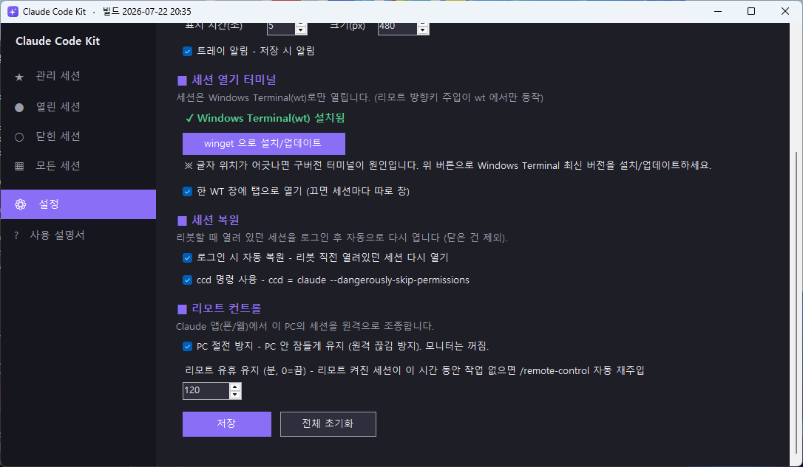


---

## 📋 요구사항
- **Windows 10 / 11**
- 아래는 **설치 마법사가 함께 깔아줍니다.** 미리 준비할 필요 없습니다.
  - **Claude Code CLI** · **Node.js** · **Git** · **Python**
  - **Windows Terminal**

## 📄 라이선스 / 제작
- **제작:** [hull.kr](https://hull.kr) · **문의:** kimkap10@gmail.com
- **무료 자유 소프트웨어(Freeware)** — 자유롭게 받아 쓰세요. 코드 서명은 하지 않았습니다.
- © 2026 hull.kr
